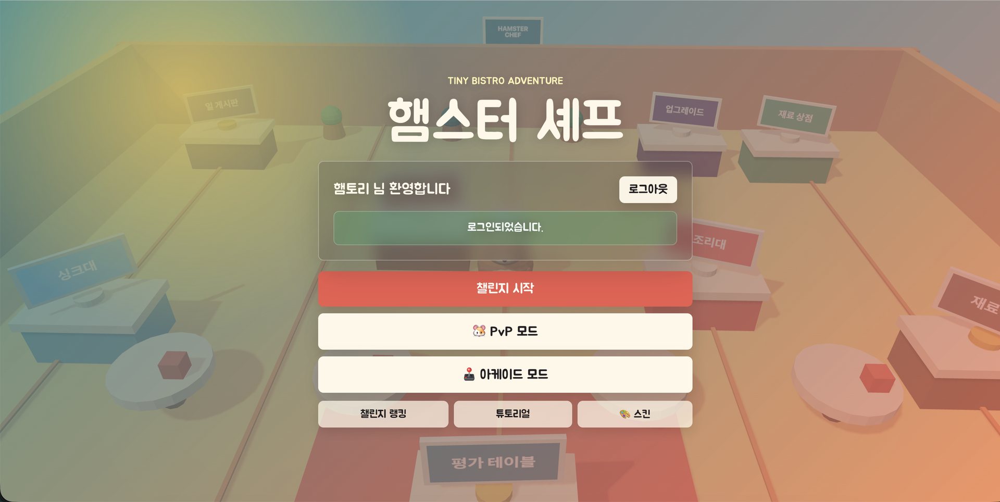
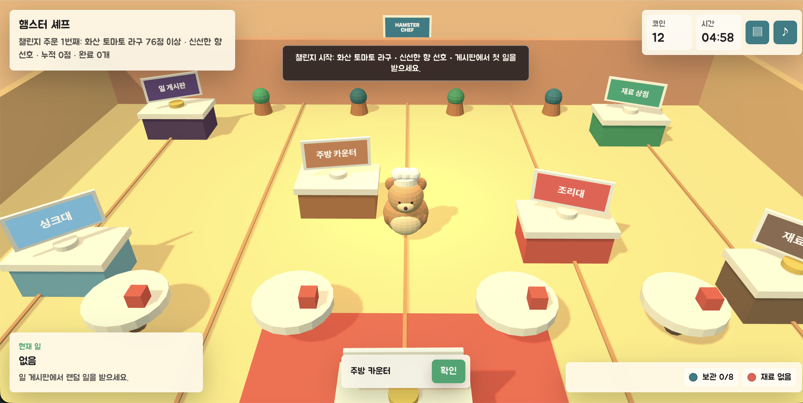
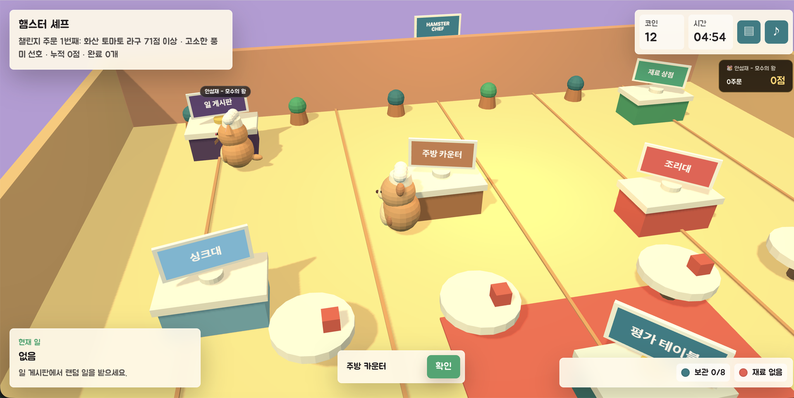
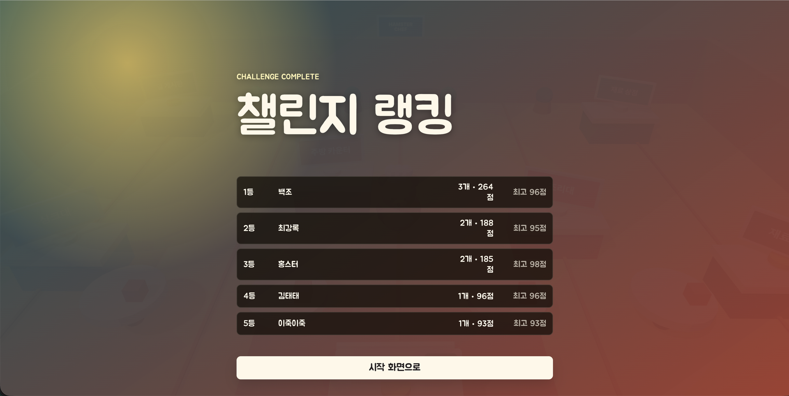

# 🐹 햄스터 셰프

> 작은 식당의 햄스터 셰프가 되어 제한 시간 안에 주문을 쳐내는 3D 요리 액션 게임.

### ▶️ 설치 없이 바로 플레이

## **[https://hamster-chef.vercel.app](https://hamster-chef.vercel.app)**

브라우저에서 링크만 열면 바로 시작합니다. 설치도 다운로드도 필요 없습니다.

---

## 👥 팀원 소개

| 이름 | 역할 | GitHub |
| --- | --- | --- |
| 이현우 | 기획 · 프로그래밍 · 아트 (1인 개발) | [@hyeon5702](https://github.com/hyeon5702) |

---

## 🎮 게임 소개

- **장르**: 3D 요리 시뮬레이션 + 실시간 1:1 대전
- **플레이 시간**: 한 판 5분
- **플랫폼**: PC 브라우저 (키보드 조작)

### 재미 포인트

- **5분 안에 몇 접시를 쳐내느냐.** 재료를 사고, 조리 미니게임을 풀고, 심사를 받는 과정이 끊기지 않고 돌아갑니다.
- **매번 다른 조리 미니게임.** 주문마다 6종 중 하나가 무작위로 배정돼서 외워서 푸는 게임이 되지 않습니다.
- **상대를 방해하는 PvP.** 넘어뜨리기, 먹물 뿌리기, 폭탄 투척으로 상대 주방을 흔들 수 있습니다.
- **혼자서도 대전.** 녹화된 라이벌 셰프 3명과 겨루는 아케이드 모드가 있어 상대가 없어도 1:1을 즐길 수 있습니다.

---

## ⌨️ 조작법

| 키 | 동작 |
| --- | --- |
| `W` `A` `S` `D` | 이동 |
| `←` `→` | 카메라 회전 |
| `↑` `↓` | 시점 각도 |
| `Shift` | 빠르게 이동 |
| `E` 또는 `Enter` | 상호작용 (스테이션, 주문 받기, 요리 제출) |
| `Tab` | 레시피 노트 |
| `Esc` | 일시정지 메뉴 |

조리 미니게임은 각 미니게임 화면의 안내를 따릅니다 (대부분 `Space` 또는 마우스).

---

## 📸 스크린샷

| | |
| --- | --- |
|  |  |
| **시작 화면** — 챌린지 / PvP / 아케이드 | **주방 플레이** — 5분 안에 주문을 쳐낸다 |
|  |  |
| **아케이드 모드** — 녹화된 라이벌과 1:1 | **챌린지 랭킹** — 전역 순위 비교 |

---

## ⬇️ 다운로드

<!-- TODO: GitHub Releases에 v1.0을 publish한 뒤 아래 링크를 채우세요. -->

[게임 다운로드 (v1.0)](https://github.com/hyeon5702/hamster_chef/releases/tag/v1.0)

---

## ▶️ 실행 방법

**가장 쉬운 방법은 위의 [플레이 링크](https://hamster-chef.vercel.app)를 여는 것입니다.**

내려받은 zip으로 직접 실행하려면 **로컬 서버가 필요합니다.**

> ⚠️ **`index.html`을 더블클릭하면 실행되지 않습니다.**
> 이 게임은 ES 모듈과 `fetch`를 사용하는데, 브라우저 보안 정책(CORS)이 `file://`에서 이를 차단하기 때문입니다. 화면이 비어 보이면 이 이유입니다.

압축을 푼 폴더에서 아래 중 하나를 실행한 뒤, 브라우저로 <http://localhost:5173> 을 엽니다.

```bash
# Python이 설치된 경우
python3 -m http.server 5173

# Node.js가 설치된 경우
npx serve -l 5173
```

VS Code를 쓴다면 **Live Server** 확장으로 `index.html`을 열어도 됩니다.

> 로그인·랭킹·PvP는 서버(Supabase)를 사용합니다. 오프라인에서는 이 기능들이 동작하지 않으니, 전체 기능을 보려면 위의 플레이 링크를 권합니다.

---

## 🕹️ 게임 모드

### 챌린지 모드

- 5분 제한. 주문이 계속 이어집니다.
- 시간을 다 쓰기 전까지 최대한 많은 주문을 성공시키는 것이 목표입니다.
- 랭킹 기준: **누적 점수 → 완료 주문 수 → 최고 단일 요리 점수 → 클리어 시간**
- 결과는 전역 랭킹에 저장돼 다른 유저와 비교할 수 있습니다.

### 🐹 PvP 모드

- 방을 만들면 6자리 코드가 나오고, 상대가 그 코드로 참가하면 매칭됩니다.
- 카운트다운 후 두 사람이 같은 조건으로 동시에 시작합니다.
- 상대 캐릭터와 이름표가 내 주방에 실시간으로 표시되고, 상대의 완료 주문 수와 점수가 화면에 계속 보입니다.
- 시간이 끝나면 누적 점수로 승패를 가립니다. 동점이면 완료 주문 수로 비교합니다.

#### 방해 기술

| 기술 | 쿨타임 | 효과 |
| --- | --- | --- |
| 넘어뜨리기 🌀 | 45초 | 상대를 5초간 넘어뜨려 움직이지 못하게 합니다. |
| 먹물 뿌리기 🖤 | 45초 | 상대 화면을 5초간 먹물로 가립니다. |
| 폭탄 투척 💣 | 35초 | 상대 주방에 폭탄을 설치합니다. |

폭탄은 30초 안에 해제해야 합니다. 폭탄으로 가서 해제 미니게임(움직이는 커서를 초록 구간에 3번 맞추기)을 성공하면 사라지고, 실패하거나 시간을 넘기면 15초 동안 이동 속도가 절반이 됩니다. 여러 개를 동시에 깔 수 있습니다.

### 🕹️ 아케이드 모드 (고스트 대결)

상대가 없어도 1:1을 할 수 있게, **실제 플레이를 녹화한 라이벌 셰프**와 겨룹니다. 상대 캐릭터의 움직임은 전부 사람이 실제로 플레이한 기록입니다.

| 난이도 | 라이벌 | 5분 성적 |
| --- | --- | --- |
| 쉬움 | 🐰 백존원 — 골목식당의 왕 | 주문 1개 · 79점 |
| 보통 | 🐱 안섬재 — 모수의 왕 | 주문 3개 · 257점 |
| 어려움 | 🤖 최감록 — 조림의 왕 | 주문 4개 · 338점 |

고스트에게는 방해 기술을 쓸 수 없습니다. 대신 **고스트가 정해진 순간에 플레이어를 방해**합니다. 대결 전에는 라이벌의 스토리 슬라이드가 나옵니다.

---

## 🔁 핵심 게임 루프

1. 일 게시판에서 퀘스트를 받아 코인을 벌거나, 바로 재료를 산다.
2. 상점에서 재료를 구매한다.
3. 조리대에서 재료를 조합하고 조리 미니게임으로 요리를 완성한다.
4. 평가 테이블에서 심사를 받아 주문을 완료한다.
5. 시간이 끝날 때까지 반복한다.

---

## 📋 콘텐츠

### 일 게시판 퀘스트 5종

| 퀘스트 | 내용 |
| --- | --- |
| 주문표 전달 | 주문 내용을 외운 뒤 제한 시간 안에 정확한 주문표를 고릅니다. |
| 반짝 접시 정리 | 더러운 접시를 중앙으로 옮겨 수세미로 문지른 뒤 닦인 칸에 놓습니다. |
| 재료 상자 정리 | 식당 바닥의 상자를 선반으로 옮깁니다. |
| 재료 선별 | 컨베이어에 올라오는 재료를 보고 정상/불량을 판정합니다. 시간을 넘기면 실패 처리됩니다. |
| 화분 물 주기 | 상점 앞 화분 4개가 마르거나 넘치지 않게 물을 조절합니다. |

### 레시피

별빛 크림 스튜 · 숲속 버섯 플레이트 · 당근 크림볼 · 황금 치즈 퐁듀

### 조리 미니게임 6종

주문마다 아래 중 하나가 무작위로 배정됩니다.

타이밍 맞추기 · 불 조절 · 재료 썰기 · 거품 걷어내기 · 반죽 치대기 · 플레이팅

최종 점수는 **재료 점수 + 미니게임 점수 + 손님 취향 보정 + 업그레이드 보너스**로 계산되며, 요리 하나당 최대 100점입니다.

### 🍪 쿠키와 스킨

판을 끝내면 쿠키를 받습니다. **완료 25 + 완료 주문당 2 + PvP 승리 15**(고스트 대결 제외).

| 스킨 | 가격 |
| --- | --- |
| 🐹 기본 햄스터 | 기본 제공 |
| 🐱 고양이 셰프 / 🐰 토끼 셰프 / 🤖 로봇 셰프 | 각 100 쿠키 |
| 😈 악당 셰프 / 🧙 마법사 셰프 | 각 150 쿠키 |

### 그 외

- 플레이형 튜토리얼
- 레시피 노트와 평가 기록
- 오늘의 이벤트 / 손님 취향 시스템
- 업그레이드 7종 (빠른 신발, 좋은 조리도구, 재료 거래처, 단골 알림판, 튼튼한 냉장고, 레시피 연구, 알바 햄스터)
- 일시정지 메뉴 (저장하고 나가기, 소리 켜기/끄기, 볼륨 조절, 조작법 보기)

---

## 🛠️ 기술 스택

| 항목 | 사용 기술 |
| --- | --- |
| 렌더링 | Three.js (CDN 모듈) |
| 언어 | 순수 JavaScript (ES 모듈), 빌드 과정 없음 |
| 백엔드 | Supabase (인증, 저장, 랭킹, PvP 방 관리, Realtime) |
| 배포 | Vercel (정적 호스팅) |

게임 엔진을 쓰지 않고 HTML/CSS/JS로 직접 만들었습니다. 별도 빌드 없이 정적 서버로 바로 실행됩니다.

### 파일 구조

```text
.
├── index.html
├── styles.css
├── src/
│   ├── main.js              # 게임 전체 로직
│   └── supabase-config.js   # Supabase URL / anon key
├── assets/
│   ├── audio/               # 배경음·효과음
│   ├── ghosts/              # 고스트 녹화본 (정적 JSON)
│   └── ghost-story/         # 고스트 스토리 일러스트
└── supabase/                # DB 스키마·RLS 정책 SQL
```

---

## ⚙️ 직접 돌려보려면 — Supabase 설정

로그인·랭킹·PvP까지 쓰려면 본인 Supabase 프로젝트가 필요합니다. (단순 플레이는 위의 배포 링크로 충분합니다.)

1. `src/supabase-config.js`에 Supabase URL과 anon key를 넣습니다.
2. Supabase **SQL Editor**에서 아래 파일들을 실행합니다. 파일만 고쳐서는 적용되지 않습니다.
   - `supabase/schema.sql` — 기본 스키마
   - `supabase/challenge_leaderboard.sql` — 챌린지 랭킹
   - `supabase/challenge_rooms.sql` — PvP 방

`challenge_rooms.sql`은 테이블뿐 아니라 RLS 정책과 가드 트리거까지 만듭니다. 트리거가 방장 자리 탈취, 참가자 덮어쓰기, 남의 방 상태 변경을 막으므로 **파일 전체를 실행해야 합니다.**

> 저장소에 포함된 anon key는 공개를 전제로 설계된 값입니다. 실제 접근 제어는 Supabase의 RLS 정책이 담당합니다. 다만 랭킹 점수는 서버에서 재계산하지 않고 DB 제약(요리당 최대 100점, 5분 상한 등)으로만 검사하므로, 순위는 재미로 봐주세요.

### 관리자모드

테스트용 패널입니다. **로컬 개발 환경(`localhost`)에서만 열립니다.** 배포본에서는 단축키와 URL 파라미터가 모두 차단됩니다.

```text
http://localhost:5173/?admin=hamster
```

또는 게임 중 `Ctrl + Shift + A`.

---

## 📝 개발 메모

- 별도 빌드 과정 없이 정적 서버로 실행됩니다.
- `npm run dev`는 `python3 -m http.server 5173`을 실행합니다.
- 수정 후에는 `node --check src/main.js`로 문법을 확인합니다.
- `index.html`의 `?v=` 쿼리스트링은 캐시 무효화용입니다. 파일을 고치면 값을 올려야 브라우저가 새 파일을 받습니다.
- 고스트 리플레이는 Supabase를 쓰지 않습니다. `assets/ghosts/`의 정적 JSON을 재생합니다.
